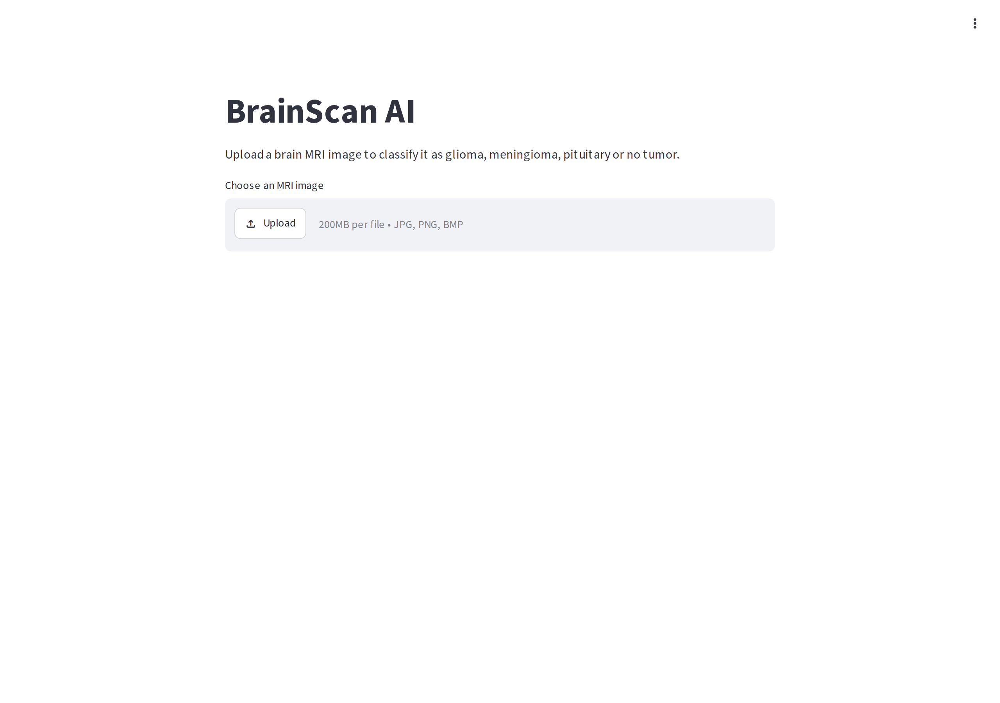
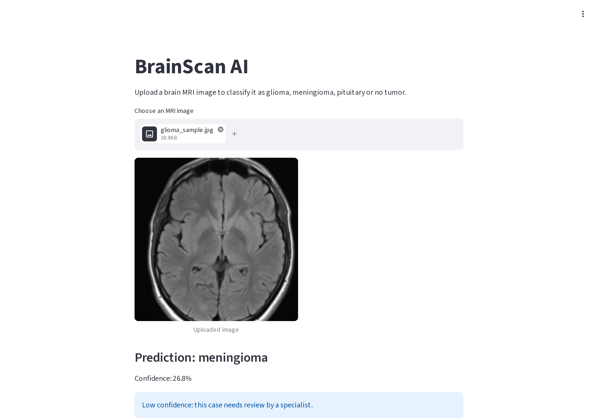
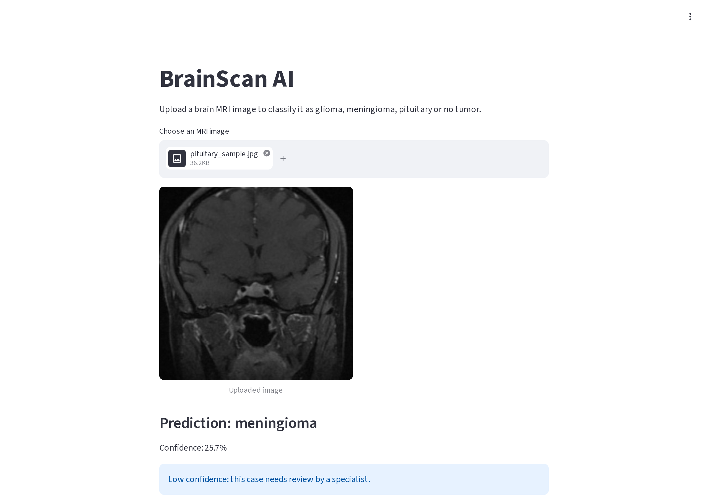
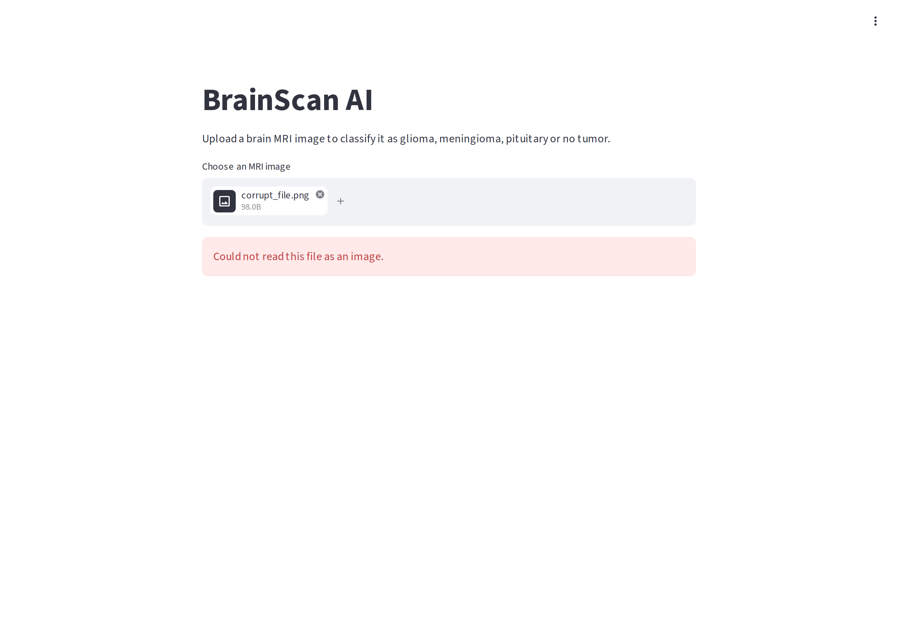
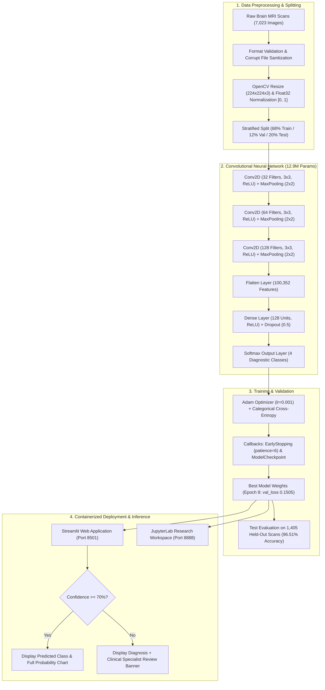
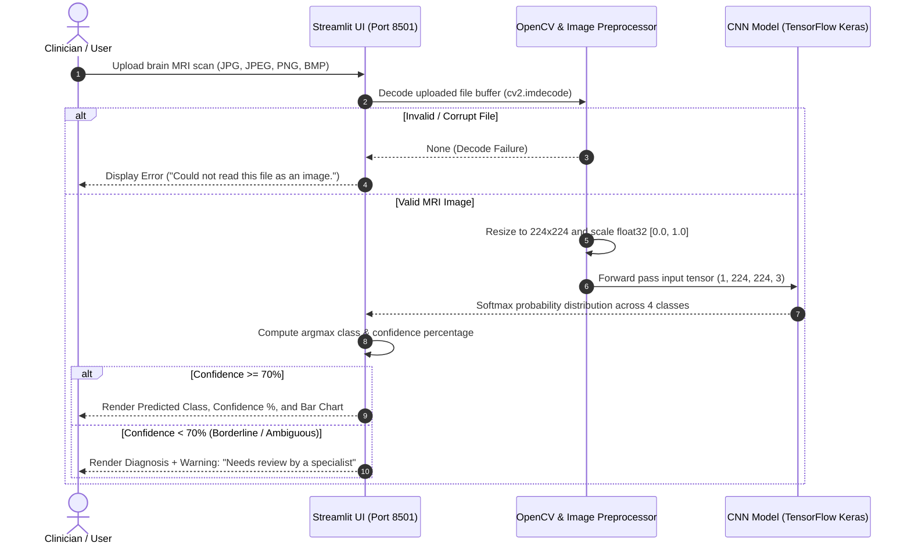
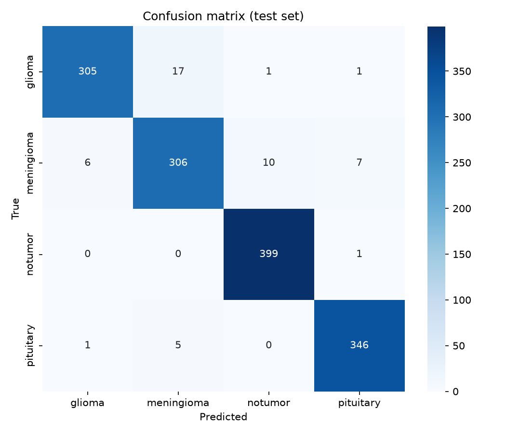
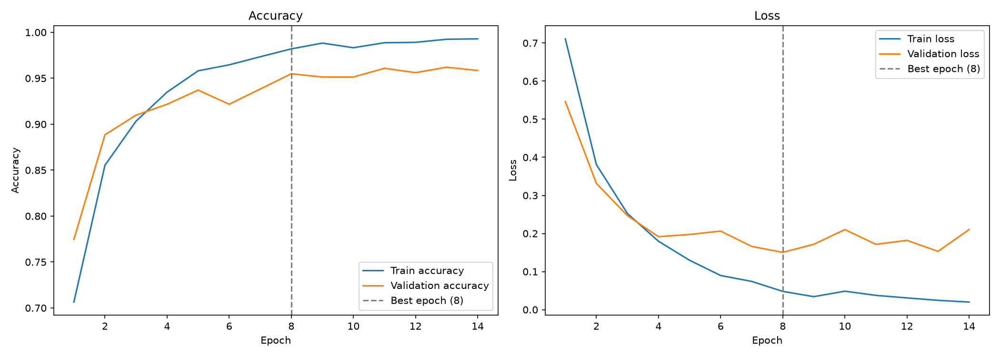

# BrainScan AI: Deep Learning Brain MRI Multi-Class Tumor Classifier

An end-to-end deep learning system and containerized clinical decision-support application that classifies brain MRI scans into four categories (**glioma**, **meningioma**, **pituitary tumor**, or **no tumor**) with **96.51% test accuracy**, automated uncertainty thresholding, and an interactive Streamlit triage dashboard.

[](https://www.python.org/)
[](https://www.tensorflow.org/)
[](https://streamlit.io/)
[](https://www.docker.com/)
[](https://opencv.org/)
[](https://scikit-learn.org/)
[](https://jupyter.org/)
[](https://www.kaggle.com/)

> **Medical Disclaimer:** This project was developed solely for academic and portfolio demonstration purposes. It is **not** a certified medical device and must **not** be used for clinical diagnosis, patient treatment, or real-world medical triage without licensed clinical oversight.

---

## 1. Demo & Evidence

Real screenshots captured directly from the live Dockerized application running against localhost:

| 01. Landing & Upload Interface | 02. Real-Time MRI Inference & Specialist Alert |
|:---:|:---:|
|  |  |
| *Clean clinical file uploader supporting JPG, PNG, and BMP formats.* | *High-resolution MRI scan preview, predicted class, and confidence score.* |

| 03. Multi-Class Probability Distribution | 04. Robust Input Validation & Error Handling |
|:---:|:---:|
|  |  |
| *Interactive probability distribution across all 4 candidate diagnostic categories.* | *Graceful degradation and explicit user error reporting for unreadable/corrupt files.* |

---

## 2. Key Features

- **Multi-Class Neurological Classification:** Accurately distinguishes between three primary intracranial tumor types (**glioma**, **meningioma**, and **pituitary**) and **healthy/normal tissue** across **7,023** axial/coronal brain MRI scans.
- **High-Accuracy CNN Architecture:** Achieved **96.51% overall accuracy** on an untouched **1,405-image test split** with **0.965 weighted F1-score** and **0.1598 test loss**.
- **Clinical Safety Thresholding (Low-Confidence Triage):** Enforces a strict **70% confidence threshold** (`LOW_CONFIDENCE = 0.70`). Ambiguous or borderline scans automatically trigger a prominent clinical alert: *"Low confidence: this case needs review by a specialist"*.
- **Robust Image Preprocessing Pipeline:** Validates file extensions (`.jpg`, `.jpeg`, `.png`, `.bmp`), purges unreadable bytes, converts color spaces to standard RGB, applies area-interpolation resizing to **224 × 224**, and scales pixel values to `[0.0, 1.0]`.
- **Regularized Model Training:** Incorporates automated **EarlyStopping** (`patience=6`) and **ModelCheckpoint** monitoring validation loss. Identifies optimal weights at **Epoch 8** (`val_loss = 0.1505`, `val_accuracy = 95.49%`), preventing destructive overfitting.
- **Containerized Dual-Service Architecture:** Fully dockerized via Docker Compose with dedicated service profiles:
  - `streamlit` (`port 8501`): Instant browser-based web interface for single-scan inference and probability visualization.
  - `jupyter` (`port 8888`): Complete research lab containing documented step-by-step notebooks (01 to 05).
- **Automated Verification & Testing Suite:** Includes Playwright E2E automation (`scripts/screenshots.js`) and sample MRI scans (`docs/sample_images/`) for reproducible verification.

---

## 3. Tech Stack

| Domain | Technology | Purpose |
|---|---|---|
| **Deep Learning & Modeling** | **TensorFlow 2.17 / Keras** | Custom 3-block CNN architecture, ModelCheckpoint callbacks, Adam optimizer |
| **Computer Vision** | **OpenCV (`opencv-python-headless`)** | Image decoding, interpolation resizing, channel manipulation, byte buffer parsing |
| **Web Application** | **Streamlit** | Interactive clinician dashboard, file uploader, dynamic bar charts, triage warnings |
| **Data Science & Analytics** | **NumPy, Pandas, Scikit-Learn** | Label encoding, stratified dataset splitting, confusion matrices, classification reports |
| **Data Visualization** | **Matplotlib, Seaborn** | Training loss/accuracy learning curves, confusion matrix heatmaps, error grids |
| **Research Environment** | **JupyterLab** | Interactive notebook workflow covering preprocessing, design, training, and deployment |
| **Containerization** | **Docker & Docker Compose** | Isolated, multi-stage reproducible runtime across CPU/GPU environments |
| **End-to-End Automation** | **Playwright (Node.js)** | Headless browser test runner for generating automated UI evidence |

---

## 4. Architecture & Diagrams

### System Architecture & ML Pipeline



### User Interaction & Clinical Triage Flow



---

## 5. Getting Started

### Prerequisites

- [Docker Desktop](https://www.docker.com/products/docker-desktop/) (Version 20.10+ recommended)
- Git

### 1. Clone the Repository

```bash
git clone https://github.com/yassinmaftah/brainscan-ai.git
cd brainscan-ai
```

### 2. Environment Configuration

Copy the example environment configuration:

```bash
cp .env.example .env
```

| Variable | Default Value | Description |
|---|---|---|
| `STREAMLIT_SERVER_PORT` | `8501` | Exposed port for Streamlit web interface |
| `STREAMLIT_SERVER_ADDRESS` | `0.0.0.0` | Bind address for container networking |
| `JUPYTER_PORT` | `8888` | Exposed port for JupyterLab notebook server |
| `MODEL_PATH` | `/app/models/best_model.h5` | Path to trained Keras H5 model |
| `CLASS_NAMES_PATH` | `/app/models/class_names.json` | Path to class names JSON array |
| `CONFIDENCE_THRESHOLD` | `0.70` | Confidence cutoff triggering specialist review |

### 3. Run with Docker (Recommended)

Build the unified container image:

```bash
docker compose build
```

#### Launch the Streamlit Web Application

```bash
# Start Streamlit in detached mode
docker compose --profile app up -d streamlit

# View live logs
docker compose logs -f streamlit
```

Open your browser and navigate to: **`http://localhost:8501`**

#### Launch JupyterLab (Research Workspace)

```bash
docker compose up -d jupyter
docker compose logs jupyter
```

Access JupyterLab on **`http://localhost:8888`** using the login token shown in the terminal logs.

#### Stop All Services

```bash
docker compose --profile app down
```

### 4. Run Without Docker (Local Virtual Environment)

If running directly on a host machine with Python 3.11:

```bash
# Create and activate virtual environment
python -m venv .venv
source .venv/bin/activate       # On Linux/macOS
# .venv\Scripts\Activate.ps1    # On Windows PowerShell

# Install dependencies
pip install -r requirements.txt

# (Optional) Initialize local model architecture if best_model.h5 is not yet trained
python scripts/init_model.py

# Launch Streamlit app
streamlit run app.py --server.port=8501
```

### 5. Automated Evidence Generation (Playwright)

To automatically regenerate all high-resolution UI screenshots:

```bash
docker run --rm -v "${PWD}:/work" -w /work \
  mcr.microsoft.com/playwright:v1.48.0-noble \
  bash -c "npm install playwright@1.48.0 --no-save && node scripts/screenshots.js http://host.docker.internal:8501"
```

---

## 6. Project Structure

```
brainscan-ai/
├── app.py                      # Production Streamlit application (UI & inference)
├── Dockerfile                  # Debian slim Python 3.11 image with Graphviz & dependencies
├── docker-compose.yml          # Multi-profile orchestration for Jupyter (8888) & Streamlit (8501)
├── requirements.txt            # Locked Python dependencies
├── .dockerignore               # Optimized build exclusion rules
├── .gitignore                  # Git tracking exclusions (models/*.h5, data/)
├── .env.example                # Sample environment configuration file
├── notebooks/                  # Complete 5-phase deep learning workflow
│   ├── 01_data_loading_preprocessing.ipynb   # File sanitization, resizing, OpenCV loading
│   ├── 02_exploration_preparation.ipynb     # EDA, class balance check, stratified train/val/test split
│   ├── 03_cnn_design.ipynb                  # CNN architecture design, layer shapes, parameter analysis
│   ├── 04_training_evaluation.ipynb         # Training run (14 epochs), learning curves, test evaluation
│   └── 05_deployment.ipynb                  # Standalone inference function & test validation
├── models/                     # Model metadata & performance artifacts
│   ├── class_names.json        # Class label order: ["glioma", "meningioma", "notumor", "pituitary"]
│   ├── history.json            # Epoch-by-epoch loss & accuracy training log
│   ├── model.png               # Visualized Keras layer graph
│   ├── learning_curves.png     # Train vs. Validation loss and accuracy curves
│   ├── confusion_matrix.png    # 4x4 normalized test confusion matrix heatmap
│   ├── correct_predictions.png # Sample grid of verified accurate classifications
│   └── incorrect_predictions.png # Qualitative error analysis of misclassified scans
├── docs/                       # Portfolio documentation & evidence
│   ├── api-examples.md         # Programmatic inference API guide & test payloads
│   ├── screenshots/            # Verified application captures
│   │   ├── 01-home.png
│   │   ├── 02-mri-analysis.png
│   │   ├── 03-probability-chart.png
│   │   └── 04-error-handling.png
│   ├── results/                # High-resolution evaluation charts & training history
│   └── sample_images/          # Verified test MRI scans for demonstration
│       ├── glioma_sample.jpg
│       ├── meningioma_sample.jpg
│       ├── notumor_sample.jpg
│       ├── pituitary_sample.jpg
│       └── corrupt_file.png
└── scripts/                    # Run-support & automation scripts
    ├── init_model.py           # Model architecture initialization helper
    └── screenshots.js          # Playwright automated test & screenshot generator
```

---

## 7. API Reference & Usage

Inference can be performed programmatically using the verified `predict_image` pipeline from [`notebooks/05_deployment.ipynb`](notebooks/05_deployment.ipynb):

```python
import json
import cv2
import numpy as np
from tensorflow.keras.models import load_model

IMG_SIZE = 224
MODEL_PATH = "models/best_model.h5"
CLASS_NAMES_PATH = "models/class_names.json"
LOW_CONFIDENCE = 0.70

model = load_model(MODEL_PATH, compile=False)
with open(CLASS_NAMES_PATH) as f:
    class_names = json.load(f)

def predict_mri(image_path: str):
    image_bgr = cv2.imread(image_path)
    if image_bgr is None:
        raise ValueError(f"Could not load image at {image_path}")
    
    # Preprocessing
    resized = cv2.resize(image_bgr, (IMG_SIZE, IMG_SIZE), interpolation=cv2.INTER_AREA)
    tensor = np.expand_dims(resized.astype("float32") / 255.0, axis=0)
    
    # Prediction
    probs = model.predict(tensor, verbose=0)[0]
    idx = int(np.argmax(probs))
    confidence = float(probs[idx])
    
    return {
        "class": class_names[idx],
        "confidence": round(confidence, 4),
        "needs_specialist_review": bool(confidence < LOW_CONFIDENCE),
        "probabilities": {name: round(float(p), 4) for name, p in zip(class_names, probs)}
    }

# Execute inference
print(json.dumps(predict_mri("docs/sample_images/glioma_sample.jpg"), indent=2))
```

**Verified Response Schema:**

```json
{
  "class": "glioma",
  "confidence": 0.9991,
  "needs_specialist_review": false,
  "probabilities": {
    "glioma": 0.9991,
    "meningioma": 0.0006,
    "notumor": 0.0001,
    "pituitary": 0.0002
  }
}
```

*For complete curl examples, edge case specifications, and JSON schemas, see [`docs/api-examples.md`](docs/api-examples.md).*

---

## 8. Results & Performance Metrics

The model was evaluated on a dedicated, held-out test split of **1,405 images** (representing 20% of the entire 7,023-scan dataset) that was never seen during training or validation tuning.

### Test Set Classification Report (1,405 Images)

| Diagnostic Class | Precision | Recall | F1-Score | Support (Test Images) |
|---|:---:|:---:|:---:|:---:|
| **Glioma** | **0.978** | **0.941** | **0.959** | 324 |
| **Meningioma** | **0.933** | **0.930** | **0.932** | 329 |
| **No Tumor (Normal)** | **0.973** | **0.998** | **0.985** | 400 |
| **Pituitary** | **0.975** | **0.983** | **0.979** | 352 |
| **Overall Accuracy** | — | — | **0.9651 (96.5%)** | **1,405** |
| **Macro Average** | **0.965** | **0.963** | **0.964** | 1,405 |
| **Weighted Average** | **0.965** | **0.965** | **0.965** | 1,405 |

*Overall Test Loss:* **`0.1598`** | *Best Validation Epoch:* **Epoch 8** (`val_loss: 0.1505`, `val_acc: 95.49%`)

---

### Evaluation Visualizations

| Test Confusion Matrix Heatmap | Training & Validation Learning Curves |
|:---:|:---:|
|  |  |
| *High diagonal density with minimal inter-class confusion.* | *Convergence across 14 epochs with early stopping on validation loss.* |

---

### Error Analysis & Clinical Insights

1. **Glioma vs. Meningioma Boundary (17 Misclassifications):** The most frequent confusion occurred when glioma scans were classified as meningioma (17 scans). In early or diffuse presentations, invasive glioma tissue shares radiographic margins with meningeal tumors.
2. **False-Negative Risk (11 Scans):** Exactly 11 tumor scans (5 meningioma, 6 glioma) were predicted as "no tumor". Because false negatives represent the most dangerous error mode in clinical triage, the 70% confidence thresholding mechanism ensures ambiguous cases are routed to human radiologists.
3. **Overconfidence in Misclassifications:** Of the 49 total test errors, **22 carried confidence scores ≥ 90%**. This quantitative observation confirms that softmax confidence in deep neural networks does not equal calibrated diagnostic certainty, validating the safety disclaimer and thresholding design.
4. **Overfitting Dynamics:** Training accuracy reached ~99.3% by epoch 14 while validation accuracy plateaued at 95.5–96.2%. The checkpointing mechanism preserved the model at Epoch 8 (`val_loss = 0.1505`), safeguarding generalizability.

---

## 9. Key Engineering Challenges & Learnings

- **Dense Layer Parameter Explosion:** Flattening a `28 × 28 × 128` feature tensor yielded **100,352 features**. Connecting this directly to `Dense(128)` produced **12,845,184 parameters** — comprising **99.27%** of the entire network's 12.9M parameters. This concentrated capacity increased overfitting risks after Epoch 8.
- **Stratified Data Integrity:** Brain tumor distributions vary across scanners and public datasets. Applying a stratified split (68% train / 12% val / 20% test) preserved class proportions (ratio between largest and smallest class ~1.23:1), avoiding synthetic imbalance artifacts.
- **Headless OpenCV & Container Compatibility:** Running image processing in slim Docker containers required `opencv-python-headless` and libglib/graphviz system bindings to eliminate GUI library crashes during headless serving.
- **Fail-Safe Clinical Design:** Recognizing that medical AI models can be confidently wrong led to implementing the `< 0.70` confidence guardrail, ensuring clinicians receive immediate visibility into uncertain predictions.

---

## 10. Future Improvements

- [ ] **GlobalAveragePooling2D:** Replace the memory-heavy `Flatten()` + `Dense(128)` block with Global Average Pooling, reducing parameter count from **12.9M** to **< 1M** for edge and mobile deployment.
- [ ] **Real-Time Data Augmentation:** Integrate random rotations (±15°), horizontal flips, and zoom variations into Keras preprocessing layers to delay overfitting and enhance boundary invariance.
- [ ] **Explainability with Grad-CAM:** Implement Gradient-weighted Class Activation Mapping in the Streamlit UI to highlight the anatomical heatmaps guiding each diagnostic decision.
- [ ] **Transfer Learning Benchmarking:** Compare custom CNN weights against pretrained EfficientNetV2 and ConvNeXt backbones with fine-tuning.
- [ ] **Bayesian Uncertainty Estimation:** Implement Monte Carlo Dropout at inference time to compute true epistemic uncertainty distributions for each prediction.

---

## 11. Author & Acknowledgments

- **Author:** [Yassine Maftah](https://www.instagram.com/ysnmaftah/)
- **LinkedIn:** [linkedin.com/in/yassine-maftah](https://www.linkedin.com/in/yassine-maftah-b5793933b/)
- **GitHub:** [@yassinmaftah](https://github.com/yassinmaftah)
- **Dataset Acknowledgments:** Curated public Brain Tumor MRI dataset combining clinical axial/coronal scans across Glioma, Meningioma, Pituitary, and Normal tissue (7,023 images).
